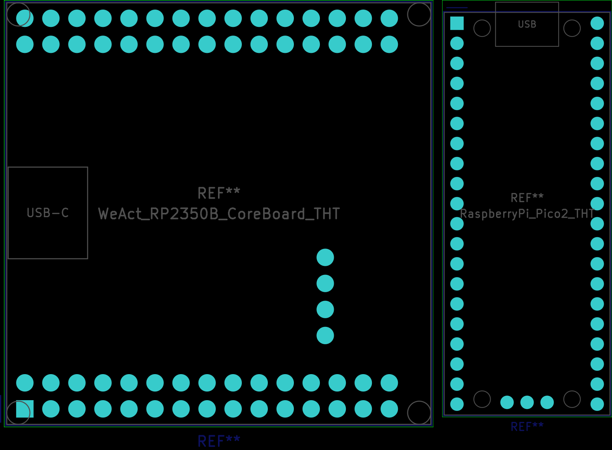
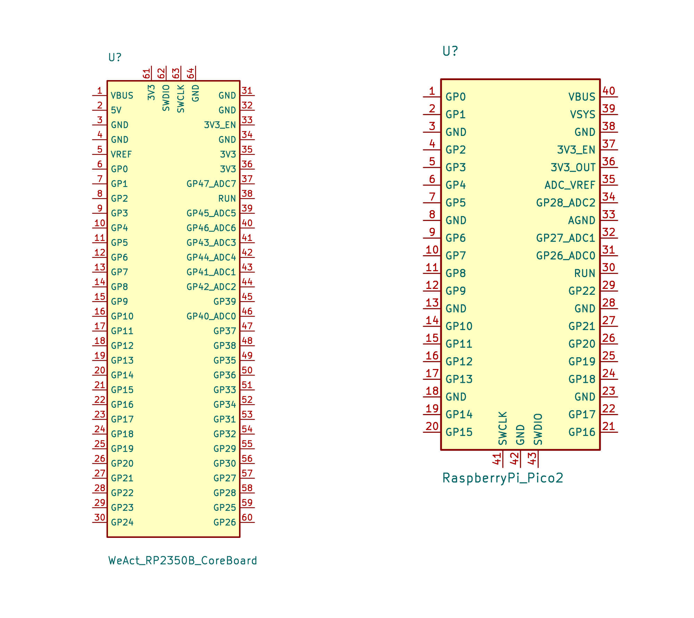

# KiCad footprints and symbols for the module boards

*Written by Claude at Bob's direction.*

This is a small KiCad library, `MCU_Module_Boards`, for designing carrier boards that host the two module boards in this repository:

| Symbol | Footprint | Board |
|---|---|---|
| `WeAct_RP2350B_CoreBoard` | `WeAct_RP2350B_CoreBoard_THT` | WeAct Studio RP2350B Core Board: 64 pins in headers H1 (2×15), H2 (2×15) and H4 (1×4, SWD) |
| `RaspberryPi_Pico2` | `RaspberryPi_Pico2_THT` | Raspberry Pi Pico 2 (RP2350A): 40 pins plus the 3-pin SWD debug header |

Each symbol's Footprint field already points to its footprint.




## Files

| File | What it is |
|---|---|
| `MCU_Module_Boards.pretty/` | Footprint library (one `.kicad_mod` per board) |
| `MCU_Module_Boards.kicad_sym` | Symbol library |
| `gen_kicad.py` | Python script that generates both libraries. All the pin positions and names are in it. |

The files are in KiCad 7 format. They were checked by loading and plotting them with `kicad-cli` 7.0. KiCad 8 and later open them and offer to save them in the newer format.

## Adding the library to a project

1. **Footprints:** in KiCad, open Preferences → Manage Footprint Libraries → Project Specific Libraries. Add `MCU_Module_Boards.pretty` with the nickname **`MCU_Module_Boards`**.
2. **Symbols:** open Preferences → Manage Symbol Libraries → Project Specific Libraries. Add `MCU_Module_Boards.kicad_sym` with the nickname **`MCU_Module_Boards`**.
3. **Use exactly that nickname.** The symbols' Footprint fields refer to the footprints as `MCU_Module_Boards:<name>`, so the link breaks under any other nickname.

## What the footprints assume

- **Orientation:**
  - The footprints are a top view of the carrier board. The module sits on top of the carrier, component side up, and its header pins point down into these holes or into sockets soldered into them.
  - This is the usual mounting, the same as the `body_bottom` soldering stand.
  - If you mount a module component side down, you need a mirrored footprint instead.
- **Pads:** 1.0 mm drill and 1.7 mm pads. These are KiCad's standard sizes for 0.1" header pins and sockets on the carrier. They are not the module's own hole sizes, which are 1.1 mm on the WeAct and 1.0 mm on the Pico 2.
- **Fabrication layer:** shows the board outline, the USB connector, and the module's mounting holes, as reference only. Nothing on it is drilled.
- **Courtyard:** follows the board outline plus 0.25 mm. On the Pico 2 it also includes the micro-USB overhang.
- **Origin:** each footprint's origin is pad 1.
- **No 3D models are attached.** WeAct's STEP file (`HDK/3D_RP350B.step` in WeAct's repository) and Raspberry Pi's Pico 2 STEP file can be added in the footprint editor if you want 3D views.

## WeAct Studio RP2350B Core Board

**Sources:**

- **Hole positions:** `HDK/3D_RP350B.step` in [WeActStudio/WeActStudio.RP2350BCoreBoard](https://github.com/WeActStudio/WeActStudio.RP2350BCoreBoard), commit `5b165b5`. This is the same data the soldering stand uses.
- **Signals:** taken from `HDK/RP2350B_PINOUT.png` and checked pin by pin against `HDK/RP2350B_SCH.pdf`.

**Pin numbering follows WeAct's schematic:**

- **Pads 1–30 are header H1.** H1 runs along the board edge with VBUS and 5V. Odd pins are on the outer row.
- **Pads 31–60 are header H2**, numbered pad = 30 + H2 pin. H2 is the other long header. WeAct numbers it with odd pins on the inner row.
- **Pads 61–64 are header H4**, the SWD header: 3V3, SWDIO, SWCLK, GND.
- In the footprint, the board's USB-C connector is on the left. H1 runs along the bottom edge, with pad 1 (VBUS) at the lower-left corner.

**Names differing from the silkscreen:**

- The pin labeled "EN" on the board is `3V3_EN` in the schematic, and the symbol uses that name.
- GPIO40–47 carry their ADC channel in the name (`GP40_ADC0` through `GP47_ADC7`).

| Pad | Signal | Pad | Signal |
|---|---|---|---|
| 1 | VBUS | 33 | 3V3_EN |
| 2 | 5V | 34 | GND |
| 3 | GND | 35 | 3V3 |
| 4 | GND | 36 | 3V3 |
| 5 | VREF | 37 | GP47_ADC7 |
| 6 | GP0 | 38 | RUN |
| 7 | GP1 | 39 | GP45_ADC5 |
| 8 | GP2 | 40 | GP46_ADC6 |
| 9 | GP3 | 41 | GP43_ADC3 |
| 10 | GP4 | 42 | GP44_ADC4 |
| 11 | GP5 | 43 | GP41_ADC1 |
| 12 | GP6 | 44 | GP42_ADC2 |
| 13 | GP7 | 45 | GP39 |
| 14 | GP8 | 46 | GP40_ADC0 |
| 15 | GP9 | 47 | GP37 |
| 16 | GP10 | 48 | GP38 |
| 17 | GP11 | 49 | GP35 |
| 18 | GP12 | 50 | GP36 |
| 19 | GP13 | 51 | GP33 |
| 20 | GP14 | 52 | GP34 |
| 21 | GP15 | 53 | GP31 |
| 22 | GP16 | 54 | GP32 |
| 23 | GP17 | 55 | GP29 |
| 24 | GP18 | 56 | GP30 |
| 25 | GP19 | 57 | GP27 |
| 26 | GP20 | 58 | GP28 |
| 27 | GP21 | 59 | GP25 |
| 28 | GP22 | 60 | GP26 |
| 29 | GP23 | 61 | 3V3 |
| 30 | GP24 | 62 | SWDIO |
| 31 | GND | 63 | SWCLK |
| 32 | GND | 64 | GND |

**On-board functions (per WeAct):**

- GPIO25 drives the LED.
- GPIO23 is the KEY button.
- GPIO0 is the chip select for an optional second flash or PSRAM.

## Raspberry Pi Pico 2

**Sources:** the *Raspberry Pi Pico 2 Datasheet* (RP-008299-DS-3). Hole positions are from Figure 3, and pin numbering and signals are from Figures 2 and 4.

**Pin numbering:**

- The numbering is Raspberry Pi's own. Pin 1 is at the top left with the USB end at the top. Pins 1–20 run down the left side and 21–40 run back up the right side.
- Pads 41–43 are the debug header: SWCLK, GND, SWDIO, from left to right.

| Pad | Signal | Pad | Signal |
|---|---|---|---|
| 1 | GP0 | 23 | GND |
| 2 | GP1 | 24 | GP18 |
| 3 | GND | 25 | GP19 |
| 4 | GP2 | 26 | GP20 |
| 5 | GP3 | 27 | GP21 |
| 6 | GP4 | 28 | GND |
| 7 | GP5 | 29 | GP22 |
| 8 | GND | 30 | RUN |
| 9 | GP6 | 31 | GP26_ADC0 |
| 10 | GP7 | 32 | GP27_ADC1 |
| 11 | GP8 | 33 | AGND |
| 12 | GP9 | 34 | GP28_ADC2 |
| 13 | GND | 35 | ADC_VREF |
| 14 | GP10 | 36 | 3V3_OUT |
| 15 | GP11 | 37 | 3V3_EN |
| 16 | GP12 | 38 | GND |
| 17 | GP13 | 39 | VSYS |
| 18 | GND | 40 | VBUS |
| 19 | GP14 | 41 | SWCLK |
| 20 | GP15 | 42 | GND |
| 21 | GP16 | 43 | SWDIO |
| 22 | GP17 | | |

**Internal functions (per the datasheet):**

- GPIO25 drives the LED.
- GPIO24 senses VBUS.
- GPIO23 controls the power supply's power-save mode.
- GPIO29/ADC3 measures VSYS/3.

## Symbol electrical types

These matter for KiCad's electrical rules check (ERC):

| Pins | Type |
|---|---|
| GND and AGND | power input |
| VBUS, VSYS and 5V | power input |
| 3V3 and 3V3_OUT | power output, because each module's regulator supplies them |
| RUN, 3V3_EN and SWCLK | input |
| VREF and ADC_VREF | passive |
| Everything else | bidirectional |

**3V3 on the WeAct board:** 3V3 appears on several pins. ERC treats them as separate power outputs, so tying them together on a carrier board can trigger a "power output connected to power output" warning. You can ignore it, or change those pins to `power_in` in the symbol if you prefer.

## Regenerating

```sh
python3 gen_kicad.py .
```

This rewrites both libraries, plus a `pin_tables.md` with the tables above. Delete that file afterward if you don't want it.
